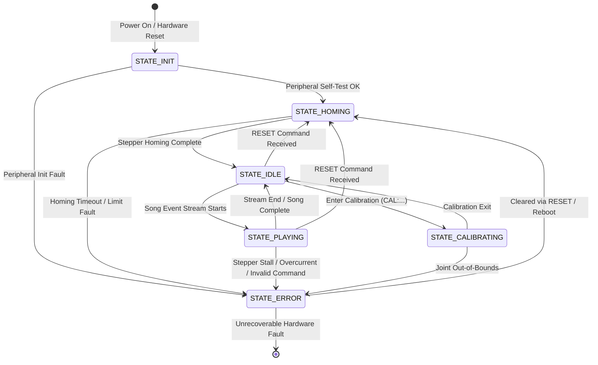

# System Architecture — Piano Hand STM32

## 1. Overview
The Piano Hand STM32 system is a multi-actuator robotic piano performer. Migrated from an ESP32 MicroPython prototype to an STM32 Nucleo-F446RE running structured, modular C firmware, the platform delivers deterministic real-time control over 5 servo-driven fingers and a lateral stepper drive. A host computer running a non-blocking asynchronous Python controller transmits timestamped musical events over Bluetooth Low Energy (BLE) to the microcontroller. The STM32 parses protocol packets, maintains motion and finger states, and commands peripheral drivers via I²C and UART interfaces.

---

## 2. Full System Architecture

```mermaid
graph TD
    subgraph Host ["Host PC (Python 3.10+)"]
        SP[Song Parser] --> HC[Host Controller / Bleak]
        NM[Note Map Translation] --> HC
        HC --> BLE_HOST[BLE Central Adapter]
    end

    BLE_HOST -.->|GATT Stream<br/>RX: 19b10001-...<br/>TX: 19b10002-...| BLE_MOD[BLE Module / UART Bridge]

    subgraph STM32 ["STM32 Nucleo-F446RE Microcontroller"]
        subgraph TransportLayer ["Transport & Protocol Layer"]
            BLE_MOD -->|UART DMA / ISR| TR[Transport Driver]
            TR --> PQ[Protocol Command Ring Buffer]
            PQ --> CD[Command Decoder & Validator]
        end

        subgraph ApplicationLayer ["Core Application Logic"]
            CD --> PHC[Piano Hand Controller SM]
            PHC --> SHED[Motion & Actuation Scheduler]
        end

        subgraph DriversLayer ["Hardware Abstraction & Drivers (BSP)"]
            SHED -->|I²C DMA| PCA[PCA9685 PWM Driver]
            SHED -->|UART 115200 8N1| STP[Stepper Motor Driver]
            ENC_HW[Rotary Encoder] -.->|Quadrature Pulses| ENC[Timer Encoder Driver]
            ENC -.->|Position Feedback (Optional)| SHED
        end
    end

    subgraph Actuators ["Robotic Piano Hand Actuators"]
        PCA -->|PWM 50Hz| S1[Servo Finger 1 (Thumb)]
        PCA -->|PWM 50Hz| S2[Servo Finger 2 (Index)]
        PCA -->|PWM 50Hz| S3[Servo Finger 3 (Middle)]
        PCA -->|PWM 50Hz| S4[Servo Finger 4 (Ring)]
        PCA -->|PWM 50Hz| S5[Servo Finger 5 (Pinky)]
        STP -->|Step/Dir/UART| LAT[Lateral Lead Screw Stepper]
    end
```

---

## 3. Module Responsibilities

| Module | Location | Primary Responsibility |
|---|---|---|
| **Host Controller** | `host/controller.py` | Connects via Bleak, maintains timing accuracy, dispatches commands without blocking, handles reconnects. |
| **Song Parser** | `host/song_parser.py` | Ingests canonical and legacy song files, normalizes timestamps to seconds, validates finger ranges. |
| **Note Map** | `host/note_map.py` | Calibration layer mapping musical notes (e.g. `C4`, `F5`) to lateral stepper key displacement. |
| **Host Protocol** | `host/protocol.py` | Encodes and validates ASCII wire commands before transmission over BLE. |
| **Transport Layer** | `firmware/Drivers/` | Interrupt/DMA-driven UART communication with BLE module; packet framing with line termination (`\n`). |
| **Command Decoder** | `firmware/Core/` | Tokenizes incoming commands, checks syntax/ranges, and enqueues executable events. |
| **Hand Controller** | `firmware/Core/` | State machine governing operating modes (Idle, Playing, Calibrating, Error, Homing). |
| **PCA9685 Driver** | `firmware/Drivers/` | I²C driver commanding 12-bit PWM registers for fingers 1 through 5. |
| **Stepper Driver** | `firmware/Drivers/` | Controls lateral carriage displacement via UART commands and hardware enable pins. |
| **Encoder Driver** | `firmware/Drivers/` | Tracks quadrature pulses via hardware timer channels for closed-loop validation (optional). |

---

## 4. End-to-End Data Flow

1. **Song Ingestion**: The user specifies a score file (`examples/hot_cross_buns.txt`). `host/song_parser.py` parses timestamps, commands, and target keys/fingers into memory.
2. **Timing & Event Dispatch**: `host/controller.py` computes elapsed wall-clock time using `asyncio.get_running_loop().time()`. When the event target time arrives, the command string is formatted via `host/protocol.py` (e.g., `0:step:-3\n` or `0:servo_on:1,3,5\n`).
3. **BLE Transport**: The payload is written to characteristic `RX_UUID` (`19b10001-e8f2-537e-4f6c-d104768a1214`).
4. **Firmware Ingestion**: The BLE module bridges incoming bytes over UART to the STM32 RX buffer using DMA or ring buffer ISR.
5. **Validation & State Transition**: The command decoder verifies boundaries (e.g. finger 1–5, non-zero int32 step displacement). Valid commands trigger state updates or actuator driver dispatches.
6. **Actuation**:
   - `servo_on`: PCA9685 channels are programmed with the active pulse length (e.g. 1.8ms press).
   - `servo_off`: PCA9685 channels are reset to rest position (e.g. 1.1ms rest).
   - `step`: Stepper driver issues target position pulses to move the lateral carriage.
7. **Telemetry / Notification**: Robot status or errors are returned via `TX_UUID` (`19b10002-e8f2-537e-4f6c-d104768a1214`) to the host logger.

---

## 5. Operating State Machine



---

## 6. Separation of Concerns (Core vs App vs Drivers / BSP)

To maintain long-term maintainability and enable headless unit testing off-target:
- **Core (`firmware/Core/`)**: Contains board-agnostic protocol parsers, command validation, state machine definitions, and mathematical conversions. These modules do not call hardware HAL directly and can be compiled on x86/ARM host environments with CMake and GoogleTest/Unity/pytest.
- **Application (`firmware/App/` or Controller Engine)**: Orchestrates sequences, handles playback queues, and computes kinematics.
- **Board Support Package & Drivers (`firmware/Drivers/` / `firmware/BSP/`)**: Houses concrete STM32 HAL wrappers for I²C, UART, DMA, and Timer peripherals. All driver dependencies are exposed via abstract interface pointers or clear C API boundaries.

---

## 7. Two-Hand Configuration Note

The system is architected to support dual-hand performance (left hand + right hand simultaneously):
- Each hand operates as an independent physical unit running its own STM32 microcontroller and BLE peripheral.
- Unique BLE device identifiers and GATT characteristics can be configured per hand (defaulting to `--hand left` or `--hand right`).
- Lateral displacement coordinates are relative:
  - For the **right hand**, positive displacement moves toward the treble (right), negative toward bass (left).
  - For the **left hand**, coordinates are configured to match physical orientation (see `host/note_map.py` calibration).
- The host controller architecture supports running concurrent `asyncio` client loops for two hands synchronized against a single master audio/score clock.
